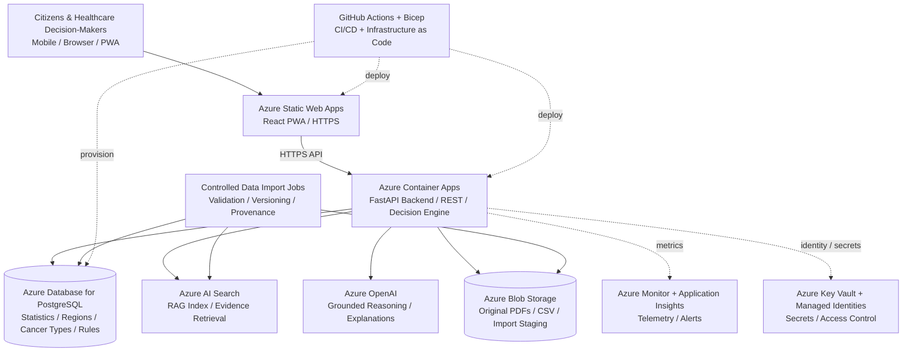
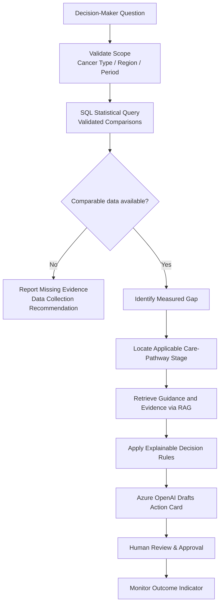
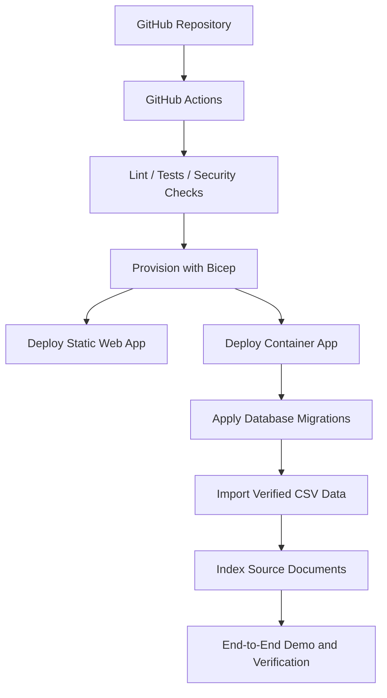

# Azure Infrastructure Roadmap

**Project:** Equal Care Navigator Across Finland  
**Challenge:** AstraZeneca — Junction 2026  
**Status:** Proposed target architecture and implementation plan — **not deployed**  
**Language:** English  
**Scope:** All cancer types; public and aggregated data for the hackathon MVP

## 1. Infrastructure Objective

Build a cloud-native, evidence-driven healthcare decision-support platform with two user experiences:

- **Citizens:** accessible cancer prevention, screening information, care navigation and support.
- **Healthcare Decision-Makers:** cancer-equity monitoring, gap identification, decision-tree analysis, evidence-backed intervention proposals and outcome monitoring.

The infrastructure must support **Identify the Gap → Locate the Gap → Recommend What to Do → Evaluate**, without presenting unverified causal claims or making autonomous clinical decisions.

For the MVP, use managed **Azure PaaS** instead of virtual machines or Kubernetes. Start with public, aggregated Finnish cancer data. Restricted health records and patient-level research data are **out of scope**.

## 2. Target Azure Architecture

**Security boundary:** The browser never connects directly to PostgreSQL, Azure OpenAI, Blob Storage or the RAG index. All privileged calls are server-side and access-controlled.

**Architecture decision:** A single modular backend container is sufficient for the MVP. Extract ingestion or AI workers only when workload characteristics justify it.

## 3. Infrastructure Components

| Layer | Azure Service | Responsibility | MVP Approach |
| --- | --- | --- | --- |
| Frontend | Azure Static Web Apps | React PWA, HTTPS, hosting and deployment | Single public PWA |
| Application server | Azure Container Apps | REST API, authorization, data validation, deterministic decision logic | One container app |
| Database | Azure Database for PostgreSQL Flexible Server | Structured statistics, regions, cancer types, indicator definitions and provenance | Small managed instance |
| Document repository | Azure Blob Storage | Source PDFs, CSV archives, staged imports | Versioned blob containers |
| RAG search | Azure AI Search | Document chunk indexing and evidence retrieval | Index selected public documents |
| Language model | Azure OpenAI | Source-grounded explanations and recommendation drafts | Limited model usage and controlled tools |
| Secret management | Azure Key Vault | Secrets and certificates when required | Managed identities where supported |
| Monitoring | Azure Monitor + Application Insights | Performance, errors, audit-safe diagnostics and alerts | Basic diagnostics |
| Provisioning | Azure Bicep | Repeatable infrastructure deployment | One declarative environment |
| Delivery | GitHub Actions | Validation, build and deploy | OIDC / workload identity federation |

**Important:** Service, region and model availability must be checked before provisioning. This roadmap is not a price quote and does not certify regulatory compliance.

## 4. Data and AI Processing

### 4.1 Data intake

Initial sources are the public, verified, English-labelled data under [Statistics](Statistics/), plus the official Finnish Cancer Registry, THL, NORDCAN and national strategy documents.

1. Obtain public source datasets with their permitted terms of use.
2. Store source copies and their version metadata in Blob Storage.
3. Validate schema, units, regional identifiers, calendar periods, numerators, denominators and data status.
4. Import structured observations into PostgreSQL.
5. Extract and chunk authoritative guidelines or strategy documents with source/page references.
6. Index eligible chunks in Azure AI Search.
7. Record import dates, source URLs, revisions and extraction provenance.

**Do not** treat forecasts or policy targets as observed statistics. **Do not** invent missing values. A coverage gap is a reportable result.

### 4.2 Decision support flow

**Responsibility split:**

- **PostgreSQL and validated application code:** exact numbers, filters, rates and statistical comparisons.
- **Decision tree:** deterministic criteria, missing-data handling and intervention eligibility.
- **RAG:** retrieval of documented evidence, references and policy context.
- **Azure OpenAI:** human-readable interpretation and proposed actions, with citations and limitations.
- **Healthcare professionals:** review medical/organisational suitability and approve any operational action.

## 5. Proposed Database Model

| Table | Key fields | Purpose |
| --- | --- | --- |
| `cancer_types` | id, classification_system, code, name | Represent all relevant cancer types |
| `regions` | id, source_region_code, name, region_type | Geographic normalization |
| `indicators` | id, name, definition, unit, methodology | Define comparable measurements |
| `data_sources` | id, publisher, source_url, publication_date, licence, version | Data provenance |
| `observations` | cancer_type_id, region_id, indicator_id, period, value, numerator, denominator, data_source_id, status | Statistical observations |
| `care_pathways` | cancer_type_id, pathway_stage, guideline_source_id | Cancer-specific pathway context |
| `decision_rules` | rule_id, condition, evidence_reference, version, status | Auditable decision tree |
| `recommendations` | gap_id, proposed_action, evidence, limitations, reviewer, review_status | Traceable interventions |

**Model safeguards:**

- Use appropriate uniqueness constraints for indicator / geography / period / population subgroup / source version.
- Preserve original source keys, definitions and collection dates.
- Track **observed**, **preliminary**, **projection**, **strategy_target** and **estimate** distinctly.
- Permit absent cancer-type or region coverage; do not imply nationwide completeness.
- Restrict administrative writes and log changes without exposing patient information.
- Protect against small-cell disclosure and inappropriate joins even when using aggregates.

## 6. Implementation Roadmap

| Phase | Milestone | Azure / Server / Database Work | Deliverable |
| --- | --- | --- | --- |
| **01** | **Azure Foundation** | Select eligible Azure region, subscription and resource group; set budgets; establish GitHub OIDC and Bicep parameters | Reproducible base environment |
| **02** | **Database & Storage** | Create PostgreSQL Flexible Server, schema and Blob Storage; define source provenance; import validated public statistics | Queryable, traceable data |
| **03** | **Backend & PWA** | Deploy FastAPI on Container Apps; deploy React PWA on Static Web Apps; implement read-only indicator API | Working end-to-end web app |
| **04** | **AI & Decision Engine** | Prepare RAG index; integrate Azure OpenAI via server; implement deterministic gap checks and evidence-backed action cards | Working AI-assisted gap analysis |
| **05** | **Security & Observability** | Apply least privilege, managed identities, suitable network isolation, monitoring and backup/restore checks | Hardened MVP |
| **06** | **Production Readiness** | Separate environments, access governance, resilient SKUs, recovery objectives, evaluations, accessibility, legal and privacy assessments | Production release candidate |

### Phase 01 — Azure Foundation

- [ ] Confirm subscription access, quotas, location and approved Azure OpenAI model availability.
- [ ] Select an EU region (evaluate **Sweden Central** first, then valid alternatives).
- [ ] Create development resource group and consistent tags.
- [ ] Configure budgets and cost alerts.
- [ ] Establish GitHub Actions OIDC / workload identity federation.
- [ ] Create initial Bicep templates and environment parameters.

### Phase 02 — Database & Data Storage

- [ ] Provision PostgreSQL Flexible Server with suitable MVP SKU and connection security.
- [ ] Create versioned schema and migration workflow with rollback and backup plan.
- [ ] Provision Blob Storage containers for immutable originals and import staging.
- [ ] Import the available `Statistics/` CSVs after validation.
- [ ] Retain source URLs, reporting periods, definitions, revision status and licensing metadata.
- [ ] Confirm that different screening programmes are not merged as if they shared definitions.

### Phase 03 — Backend & PWA

- [ ] Deploy one Container Apps backend with HTTPS ingress.
- [ ] Expose documented endpoints for available cancer types, regions and indicators.
- [ ] Expose **read-only** statistical queries for citizens and decision-makers as appropriate.
- [ ] Deploy accessible React PWA with clear separate entry points.
- [ ] Keep Azure and database credentials out of the client.
- [ ] Introduce authorization for decision-maker and administrative operations.

### Phase 04 — RAG, Decision Tree & AI

- [ ] Store approved strategy and roadmap source documents with versions.
- [ ] Build chunked RAG index with document names and page references.
- [ ] Implement statistical comparisons with deterministic calculations.
- [ ] Implement decision rules for **Identify → Locate → Recommend → Evaluate**.
- [ ] Use source-backed tool outputs to ground all generated explanations.
- [ ] Return **insufficient evidence** where comparison or pathway evidence is missing.
- [ ] Produce an Action Card: finding, cited data, interpretation, uncertainty, intervention candidate, review step and KPI.

### Phase 05 — Security & Monitoring

- [ ] Use least-privilege Azure RBAC and managed identities where supported.
- [ ] Secure PostgreSQL connections and data storage; introduce private connectivity as justified by the environment.
- [ ] Record service logs without sensitive content in prompts or telemetry.
- [ ] Set availability, failure and cost alerts.
- [ ] Verify database backup retention and run a restore test.
- [ ] Add deployment security checks and rollback steps.

### Phase 06 — Production Readiness

- [ ] Separate development, staging and production configurations.
- [ ] Assess the need for private endpoints and dedicated network integration.
- [ ] Define RPO/RTO, scaling limits and high availability configuration.
- [ ] Run load, accessibility, reliability and AI-quality evaluations.
- [ ] Establish formal data governance and model evaluation procedures.
- [ ] Complete GDPR, security, AI Act and potential medical-device regulatory assessments as applicable before any real-world deployment.
- [ ] Obtain expert review of clinical claims, intervention suggestions and monitoring logic.

## 7. Deployment Workflow

**CI/CD principles:** OIDC rather than long-lived credentials, environment-scoped permissions, safe migrations, repeatable deployments and explicit rollback or forward-fix strategy.

## 8. MVP vs Production

| Area | Junction MVP | Production Target |
| --- | --- | --- |
| PWA | Functional mobile-first demo | Accessible, multilingual product |
| API | Single Container App | Autoscaled and monitored service |
| PostgreSQL | Small managed instance | Appropriate HA, restore and lifecycle procedures |
| Data import | Validated, manual or controlled batch imports | Scheduled, audited ingestion |
| RAG | Strategy and roadmap excerpts | Governed, versioned evidence corpus |
| Decision tree | Transparent rules using available public measures | Expert-reviewed rule lifecycle |
| AI | Grounded explanations with visible uncertainty | Continuous evaluation, review and audit controls |
| Privacy | Public, aggregated data only | Formal security/privacy/regulatory assurance |

## 9. Azure Region, Network and Cost Considerations

**Region:** Consider Sweden Central for EU proximity, but verify all required model deployments and services in the same acceptable geography. Cross-region processing and data-residency conditions must be reviewed.

**Network:** For a quick public-data MVP, minimize complexity while securing the database and API. For a later production release, use private database connectivity, scoped ingress, dedicated subnets and private endpoints where supported and appropriate. Network choices for PostgreSQL require advance planning.

**Cost drivers:** Azure OpenAI token usage, AI Search pricing, PostgreSQL compute/storage, Container Apps workloads, monitoring retention and networking. Apply budgets and quotas. No unverified fixed monthly cost estimate is provided.

**No virtual machine required for MVP:** Container Apps hosts the server workload, while PostgreSQL Flexible Server manages the database lifecycle. AKS and Debian VMs are optional only if later requirements justify them.

## 10. Definition of Done — Azure MVP

- [ ] React PWA is accessible over HTTPS.
- [ ] FastAPI backend runs on Azure Container Apps.
- [ ] PostgreSQL contains validated Finnish cancer statistics with source provenance.
- [ ] Data can be filtered by cancer type, region and year **where such dimensions are available**.
- [ ] The Decision Tree can identify at least one documented statistical inequality.
- [ ] RAG returns source-linked relevant evidence.
- [ ] Azure OpenAI produces an evidence-backed Action Card with caveats.
- [ ] Missing pathway data are explicitly reported rather than fabricated.
- [ ] No patient-level personal health data are used.
- [ ] Infrastructure and application can be redeployed from GitHub.

## 11. Project References

- [Junction Challenge Requirements](CHALLENGE_REQUIREMENTS.md)
- [English Statistics and Data Sources](Statistics/README.md)
- [Documented Equity Gaps](Statistics/EQUITY_GAPS.md)
- [Finnish Cancer Strategy 2026–2035](https://files.hackjunction.app/resources/Kansallinen_syopastrategia_2026_2035_FINAL.pdf)
- [Implementation Roadmap 2026–2031](https://files.hackjunction.app/resources/Kansallinen_syopastrategia_toimeenpanon_tiekartta_2026_2031.pdf)
- [Azure Container Apps documentation](https://learn.microsoft.com/azure/container-apps/overview)
- [Azure Database for PostgreSQL documentation](https://learn.microsoft.com/azure/postgresql/flexible-server/overview)
- [Azure Static Web Apps documentation](https://learn.microsoft.com/azure/static-web-apps/overview)
- [Azure AI Search documentation](https://learn.microsoft.com/azure/search/search-what-is-azure-search)
- [Azure OpenAI documentation](https://learn.microsoft.com/azure/ai-services/openai/overview)

---

**Document intent:** Planning blueprint only. No Azure resources are provisioned by adding this document to the repository.
