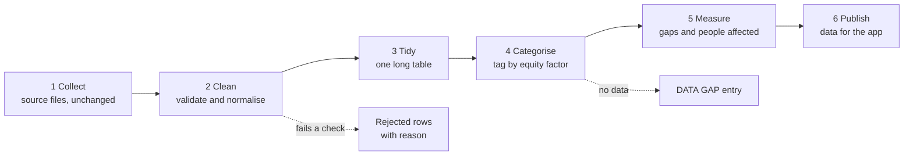

# Data Pipeline

**Project:** Equal Care Navigator Across Finland
**Status:** Proposal. The cleaning and categorising steps are not built yet.
**Purpose:** Turn the public statistics we have into one clean table, and tag every number by the equity factor it tells us about.

## 1. What we mean by "risk factor"

In this project a risk factor is **not** a lifestyle risk such as smoking or weight. It is a characteristic of a population group that goes along with lower use of prevention, screening or care:

- lower income
- lower education
- a native language other than Finnish, Swedish or Sámi
- further factors where data exists: sex, distance to care, access to occupational health care

To avoid confusion with clinical risk, this document calls them **equity factors**. The demo can still say "risk factor" as long as it explains the meaning once.

An equity factor describes a group, never a person. The pipeline must not produce individual risk scores.

## 2. What the data can and cannot show

Our data supports three kinds of statement. They differ a lot in strength, so every number carries one of these labels.

| Evidence type | What it is | Example we have | How strong |
| --- | --- | --- | --- |
| **A. Stratified** | The source publishes the outcome separately for each group | Cervical screening 2025 (preliminary): 50.3 % participation with primary or unknown education, 80.8 % with tertiary education | Strongest. A direct comparison of groups |
| **B. Regional** | The outcome is published per region and compared with a regional characteristic | Breast screening 2024 is lowest in regions with many other-language speakers (rank correlation −0.78 across 22 regions) | Weak. Shows a pattern between regions, not between people |
| **C. Documented** | A cited document describes the barrier, but no open number exists | Roadmap p. 11: people without occupational health care wait longer for a diagnosis | Qualitative. Show as text, never as a chart |

Type B needs care. At regional level, poorer regions take part in screening slightly **more** often, because they are rural and rural regions have high participation. The income effect only appears at municipality level (rank correlation −0.20 for colorectal, −0.27 for cervical, about 300 municipalities). Regional averages can hide or reverse what is true for people.

None of the three types proves a cause. The pipeline reports differences; it does not explain them.

## 3. Pipeline overview

### Step 1: Collect

Keep every source file exactly as downloaded, with its URL and download date. Never edit these files by hand.

### Step 2: Clean

Each row must pass these checks. A row that fails goes to a rejected list with the reason; it is not repaired by guessing.

| Check | Rule |
| --- | --- |
| Region | Map every name to one fixed list: 21 wellbeing services counties, City of Helsinki, Finland. Note whether Åland is included |
| Period | A single year or an explicit range. No mixing of years inside one comparison |
| Unit | Percent, count, per 1,000 or index. Stored with the value |
| Arithmetic | Where invited and attended counts exist, attended ÷ invited must match the published percent within rounding |
| Status | One of: observed, preliminary, projection, strategy_target, estimate |
| Missing values | Stay empty. Never zero, never filled in |
| Duplicates | Same indicator, region, period and group may appear only once per source version |
| Source | Every row has a URL |

### Step 3: Tidy

All sources end in one long table with one observation per row. The columns match the `observations` table in [AZURE_INFRASTRUCTURE_ROADMAP.md](AZURE_INFRASTRUCTURE_ROADMAP.md).

| Column | Example |
| --- | --- |
| `indicator` | screening_participation |
| `programme` | cervical |
| `pathway_stage` | early_detection |
| `region` | Finland |
| `period` | 2025 |
| `factor` | education |
| `factor_level` | primary_or_unknown |
| `value`, `unit` | 50.3, percent |
| `numerator`, `denominator` | 16387, 32558 |
| `status` | preliminary |
| `evidence_type` | A |
| `source_url` | https://stats.cancerregistry.fi/… |

Rows for the whole population use `factor = none`.

### Step 4: Categorise by equity factor

Each factor has a fixed definition, so the same word always means the same measurement.

| Factor | Levels or measure | Stratified data (type A) | Regional measure (type B) |
| --- | --- | --- | --- |
| Education | primary or unknown, secondary, tertiary | Cervical screening 2025 | Education level index, Sotkanet 180 |
| Native language | domestic, other or not recorded | Cervical screening 2025 | Other native language per 1,000, Sotkanet 187 |
| Income | not available by group | none found yet | Low-income rate, Sotkanet 3099 |
| Sex | men, women | Colorectal screening 2024, Sotkanet 6103 | not needed |
| Primary care access | not available by group | none | Doctor wait over 7 days, Sotkanet 6411 (all patients, not cancer-specific) |
| Distance to care | not available | none | none. Documented only, roadmap p. 13 |
| Occupational health access | not available | none | none. Documented only, roadmap p. 11 |

A factor with no stratified and no regional data produces a **DATA GAP** entry with the document reference, not an estimate.

### Step 5: Measure

For every factor with type A data, compute three figures:

- **Absolute gap** in percentage points between the highest and lowest group.
- **People affected:** the size of the lower group (its denominator).
- **Potential:** additional participants if the lower group reached a stated reference group. This is arithmetic on published counts, not a forecast of what a measure achieves.

For type B data, report only the rank correlation, the number of regions, and the level (region or municipality).

Factors are reported side by side. They overlap strongly, so gaps must not be added or multiplied into one combined score.

### Step 6: Publish

Write one file for the app with observations, gaps and DATA GAP entries. Each figure keeps its status, evidence type and source so the interface can label it.

## 4. What exists today

| Item | Where | State |
| --- | --- | --- |
| National key statistics | `Statistics/national_key_statistics.csv` | on `main` |
| Breast screening by region 2024 | `Statistics/breast_screening_by_region_2024.csv` | on `main` |
| Cervical screening by education and language 2025 | `Statistics/cervical_screening_equity_2025_preliminary.csv` | on `main` |
| Colorectal screening by region and sex 2024 | `Statistics/colorectal_screening_by_region_2024.csv` | on branch `Lukas_ARK` |
| Cervical screening by region 2024 | `Statistics/cervical_screening_by_region_2024.csv` | on branch `Lukas_ARK` |
| National trend 2021–2024 | `Statistics/screening_participation_national_trend.csv` | on branch `Lukas_ARK` |
| Regional context 2024 (income, education, language, primary care wait) | `Statistics/region_context_2024.csv` | on branch `Lukas_ARK` |
| Download script for the Sotkanet files | `Statistics/fetch_sotkanet.py` | on branch `Lukas_ARK` |
| Cleaning checks, long table, factor tagging, gap measures | – | not built |

The existing CSV files do not share one layout. Some have invited and attended counts, the Sotkanet files have attended counts only, and the context file is already in long format. Step 3 exists to remove these differences.

## 5. Open questions

1. **Stratified data for breast and colorectal screening.** The Finnish Cancer Registry publishes cervical screening by education and language. Whether the same tables exist for the other two programmes has not been checked. This would be the most valuable addition.
2. **Income by group.** We have no source that reports participation by income group. Without one, income stays at type B.
3. **Beyond screening.** Stage at diagnosis, referral time and time to treatment have no open data by equity factor. The roadmap cites a register study on socioeconomic differences (BMJ Public Health 2025;3:e002829) that may provide published figures.
4. **Municipality level.** About 300 municipalities give more statistical power than 22 regions, but small municipalities have unstable percentages. A minimum number of invited people is needed before a municipality is shown.

## 6. Rules that apply to every step

- Use published aggregates only. No patient-level data.
- Do not fill gaps with simulated or estimated values.
- Keep preliminary figures labelled as preliminary wherever they appear.
- Do not compare programmes as if they shared a definition; target ages and invitation rules differ.
- State differences, not causes.
