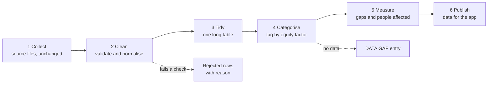

# Data Pipeline

**Project:** Equal Care Navigator Across Finland
**Status:** Working prototype in [pipeline/](pipeline/). Sections 1–3 describe the design; section 7 describes what the prototype does.
**Purpose:** Turn the public statistics we have into one clean table, and tag every number by the equity factor it tells us about.

## 1. What we mean by "risk factor"

In this project a risk factor is **not** a lifestyle risk such as smoking or weight. It is a characteristic of a population group that goes along with lower use of prevention, screening or care:

- lower income
- lower education
- a native language other than Finnish, Swedish or Sámi
- further factors where data exists: sex, distance to care, access to occupational health care

To avoid confusion with clinical risk, this document calls them **equity factors**. The demo can still say "risk factor" as long as it explains the meaning once.

An equity factor describes a group, never a person. The pipeline must not produce individual risk scores.

## 2. What the data can and cannot show

Our data supports three kinds of statement. They differ a lot in strength, so every number carries one of these labels.

| Evidence type | What it is | Example we have | How strong |
| --- | --- | --- | --- |
| **A. Stratified** | The source publishes the outcome separately for each group | Cervical screening 2025 (preliminary): 50.3 % participation with primary or unknown education, 80.8 % with tertiary education | Strongest. A direct comparison of groups |
| **B. Regional** | The outcome is published per region and compared with a regional characteristic | Breast screening 2024 is lowest in regions with many other-language speakers (rank correlation −0.78 across 22 regions) | Weak. Shows a pattern between regions, not between people |
| **C. Documented** | A cited document describes the barrier, but no open number exists | Roadmap p. 11: people without occupational health care wait longer for a diagnosis | Qualitative. Show as text, never as a chart |

Type B needs care. At regional level, poorer regions take part in screening slightly **more** often, because they are rural and rural regions have high participation. The income effect only appears at municipality level (rank correlation −0.20 for colorectal, −0.27 for cervical, about 300 municipalities). Regional averages can hide or reverse what is true for people.

None of the three types proves a cause. The pipeline reports differences; it does not explain them.

## 3. Pipeline overview



### Step 1: Collect

Keep every source file exactly as downloaded, with its URL and download date. Never edit these files by hand.

### Step 2: Clean

Each row must pass these checks. A row that fails goes to a rejected list with the reason; it is not repaired by guessing.

| Check | Rule |
| --- | --- |
| Region | Map every name to one fixed list: 21 wellbeing services counties, City of Helsinki, Finland. Note whether Åland is included |
| Period | A single year or an explicit range. No mixing of years inside one comparison |
| Unit | Percent, count, per 1,000 or index. Stored with the value |
| Arithmetic | Where invited and attended counts exist, attended ÷ invited must match the published percent within rounding |
| Status | One of: observed, preliminary, projection, strategy_target, estimate |
| Missing values | Never zero and never filled silently. A labelled fallback value may be added later, see section 7 |
| Duplicates | Same indicator, region, period and group may appear only once per source version |
| Source | Every row has a URL |

### Step 3: Tidy

All sources end in one long table with one observation per row. The columns match the `observations` table in [AZURE_INFRASTRUCTURE_ROADMAP.md](AZURE_INFRASTRUCTURE_ROADMAP.md).

| Column | Example |
| --- | --- |
| `indicator` | screening_participation |
| `programme` | cervical |
| `pathway_stage` | early_detection |
| `region` | Finland |
| `period` | 2025 |
| `factor` | education |
| `factor_level` | primary_or_unknown |
| `value`, `unit` | 50.3, percent |
| `numerator`, `denominator` | 16387, 32558 |
| `status` | preliminary |
| `evidence_type` | A |
| `source_url` | https://stats.cancerregistry.fi/… |

Rows for the whole population use `factor = none`.

### Step 4: Categorise by equity factor

Each factor has a fixed definition, so the same word always means the same measurement.

| Factor | Levels or measure | Stratified data (type A) | Regional measure (type B) |
| --- | --- | --- | --- |
| Education | primary or unknown, secondary, tertiary | Cervical screening 2025 | Education level index, Sotkanet 180 |
| Native language | domestic, other or not recorded | Cervical screening 2025 | Other native language per 1,000, Sotkanet 187 |
| Income | not available by group | none found yet | Low-income rate, Sotkanet 3099 |
| Sex | men, women | Colorectal screening 2024, Sotkanet 6103 | not needed |
| Primary care access | not available by group | none | Doctor wait over 7 days, Sotkanet 6411 (all patients, not cancer-specific) |
| Distance to care | not available | none | none. Documented only, roadmap p. 13 |
| Occupational health access | not available | none | none. Documented only, roadmap p. 11 |

A factor with no stratified and no regional data produces a **DATA GAP** entry with the document reference, not an estimate.

### Step 5: Measure

For every factor with type A data, compute three figures:

- **Absolute gap** in percentage points between the highest and lowest group.
- **People affected:** the size of the lower group (its denominator).
- **Potential:** additional participants if the lower group reached a stated reference group. This is arithmetic on published counts, not a forecast of what a measure achieves.

For type B data, report only the rank correlation, the number of regions, and the level (region or municipality).

Factors are reported side by side. They overlap strongly, so gaps must not be added or multiplied into one combined score.

### Step 6: Publish

Write one file for the app with observations, gaps and DATA GAP entries. Each figure keeps its status, evidence type and source so the interface can label it.

## 4. What exists today

| Item | Where | State |
| --- | --- | --- |
| National key statistics | `Statistics/national_key_statistics.csv` | on `main` |
| Breast screening by region 2024 | `Statistics/breast_screening_by_region_2024.csv` | on `main` |
| Cervical screening by education and language 2025 | `Statistics/cervical_screening_equity_2025_preliminary.csv` | on `main` |
| Colorectal screening by region and sex 2024 | `Statistics/colorectal_screening_by_region_2024.csv` | on branch `Lukas_ARK` |
| Cervical screening by region 2024 | `Statistics/cervical_screening_by_region_2024.csv` | on branch `Lukas_ARK` |
| National trend 2021–2024 | `Statistics/screening_participation_national_trend.csv` | on branch `Lukas_ARK` |
| Regional context 2024 (income, education, language, primary care wait) | `Statistics/region_context_2024.csv` | on branch `Lukas_ARK` |
| Download script for the Sotkanet files | `Statistics/fetch_sotkanet.py` | on branch `Lukas_ARK` |
| Cleaning checks, long table, factor tagging, gap measures | `pipeline/` | prototype, see section 7 |
| Screening by education, language and sex, all three programmes, 2020–2025 | `Statistics/screening_by_population_group.csv` | written by `pipeline/fetch_screening_groups.py` |
| Income, education, language, smoking and primary care wait by region | `Statistics/equity_context_raw.csv.gz` | written by `pipeline/fetch_context.py` |

The existing CSV files do not share one layout. Some have invited and attended counts, the Sotkanet files have attended counts only, and the context file is already in long format. Step 3 exists to remove these differences.

## 5. Open questions

1. **Stratified data for breast and colorectal screening.** Resolved: the Finnish Cancer Registry publishes all three programmes by education and native language for 2020–2025. `pipeline/fetch_screening_groups.py` extracts them.
2. **Income by group.** We have no source that reports participation by income group. Without one, income stays at type B.
3. **Beyond screening.** Stage at diagnosis, referral time and time to treatment have no open data by equity factor. The roadmap cites a register study on socioeconomic differences (BMJ Public Health 2025;3:e002829) that may provide published figures.
4. **Municipality level.** About 300 municipalities give more statistical power than 22 regions, but small municipalities have unstable percentages. A minimum number of invited people is needed before a municipality is shown.

## 6. Rules that apply to every step

- Use published aggregates only. No patient-level data.
- Do not fill gaps silently. A fallback value is allowed only if it is labelled `imputed`, names its method and the values it was built from, and stays out of the gap measures.
- Keep preliminary figures labelled as preliminary wherever they appear.
- Do not compare programmes as if they shared a definition; target ages and invitation rules differ.
- State differences, not causes.

## 7. Prototype

The prototype splits the six design steps into 18 smaller ones. It uses only the Python standard library. All thresholds and file lists are in `pipeline/config.json`.

```
python3 pipeline/run_pipeline.py                      # run all 18 steps, about 25 seconds
python3 pipeline/run_pipeline.py --upload             # run, then upload fact sheets and CSVs to Azure
python3 -m unittest discover -s pipeline/tests -v     # 17 unit tests
```

Refreshing the inputs needs a network connection and is separate from the run:

```
python3 pipeline/fetch_context.py             # income, education, language, smoking, population (Sotkanet)
python3 pipeline/fetch_screening_groups.py    # screening by education, language and sex (Finnish Cancer Registry)
python3 pipeline/fetch_region_shapes.py       # region boundaries for the map (Statistics Finland)
```

Each fetch script retries on network errors and reports per source whether the data changed since the last download.

| # | Step | Design step | What it does |
| ---: | --- | --- | --- |
| 1 | ingest | Collect | Reads six source files into one raw layout; records file checksum and line number of every row |
| 2 | profile | Collect | Describes the input per source: rows, empty fields, vocabularies, year range |
| 3 | validate_schema | Clean | Required fields, year format, numeric value, valid JSON; trims text and unifies Unicode |
| 4 | standardise | Clean | One vocabulary for regions, sex, age groups, units and indicators; Sotkanet regions are resolved by id because names repeat |
| 5 | scope_filter | Clean | Keeps country, wellbeing services county, Åland and municipality level |
| 6 | deduplicate | Clean | Same observation, same value: keep the row with more of the underlying counts. Different value: keep the preferred source, quarantine the other |
| 7 | quality_checks | Clean | Range, date and arithmetic rules reject impossible values; outliers and small cells are flagged, not removed |
| 8 | completeness | Clean | Lists missing region-year cells and information no open source provides |
| 9 | impute | Clean | Adds a labelled fallback value for missing region-year cells, see below |
| 10 | integrate | Tidy | Final long table with stable ids, plus a small analysis subset |
| 11 | enrich | Categorise | One profile per region: six context values and population |
| 12 | derive | Measure | Base of each percentage, 95 % confidence interval, three-year average, position against the 80 % screening target |
| 13 | categorise | Categorise | Per factor: thirds of regions (relative) and worse or better than Finland (absolute); tags every outcome with factor and evidence type |
| 14 | measure | Measure | Gaps between groups with confidence interval (A); regional comparison, population-weighted, with permutation test and correction for multiple comparisons (B); the same across municipalities; documented barriers (C) |
| 15 | recommend | Measure | Links each gap to a measure from the national roadmap, with cost, page and success indicator |
| 16 | trends | Measure | Deaths by cancer site and year; new treatment entitlements per region |
| 17 | compare_runs | Publish | Lists every analysis figure that is new, gone or different since the previous run |
| 18 | publish | Publish | Writes all outputs, fact sheets, lineage and a run report; fails if any input row is unaccounted for |

Rejected rows go to `quarantine.csv` with the step and reason. They are never repaired.

### Fallback values for missing data (step 9)

A region-year cell is missing when an indicator has no value for one of the 22 regions in a year between its first and last published year. Step 9 fills such a cell with the first rule that applies:

| Order | Method | When | Fallback value |
| ---: | --- | --- | --- |
| 1 | `temporal_mean` | The region has a value within two years before **and** after | Average of those two values |
| 2 | `nearest_year` | The region has a value within two years on one side only | That value |
| 3 | `regional_mean` | The region has nothing nearby, but at least five other regions reported that year | Unweighted average of those regions |
| – | none | Otherwise | The cell stays empty |

Every fallback row has `status = imputed`, the method, and the values it was built from. It is never the basis for another fallback, and information that no source publishes at all is never filled. Fallback values are published but **not** used in the gap measures unless `use_imputed_in_measures` is set in `config.json`.

### How certainty is handled (steps 12 and 14)

- **Confidence intervals.** Every percentage with a known base gets a 95 % Wilson interval. A region counts as below the screening target only if its whole interval lies below 80 %; otherwise it is "near target".
- **Derived bases.** Where a source publishes participants and percentage but not the number invited, the base is recovered from the two and marked `derived`.
- **Three-year averages.** Regional comparisons use the average of the latest three years, which steadies small regions.
- **Weights.** Regional gaps are reported unweighted and weighted by population.
- **Many comparisons.** 42 region-level and 15 municipality-level comparisons are tested. Each gets a p-value (permutation test for 22 regions, normal approximation for municipalities) and a Holm-adjusted p-value. Only patterns with an adjusted p-value below 0.05 are marked `robust`.

### Recommendation rules (step 15)

| Trigger | Measure | Fit |
| --- | --- | --- |
| National gap by education in screening participation | 1.1.1 Co-design screening and prevention services with residents | direct |
| National gap by native language in screening participation | 1.3.1 Targeted communication for language groups | direct |
| National gap between men and women | 2.4.1 Screening quality manuals | closest match |
| National gap in attendance at the follow-up examination | 1.2.3 Named care coordinator | closest match |
| No open data on referral, diagnosis and treatment times | 3.1.2 National care pathways with public monitoring | direct |
| Region clearly below 80 % and in the disadvantaged third for language | 1.3.1 | direct |
| Region clearly below 80 % and in the disadvantaged third for education | 1.1.1 | direct |
| Region clearly below 80 %, neither of the two | 2.4.1 | direct |
| Region in the disadvantaged third for primary care waits | 2.5.1 More physician capacity in primary care | direct |

A national gap leads to a recommendation only if the newest full year shows it and its confidence interval lies above zero. "Closest match" means the roadmap has no measure aimed exactly at that gap. Costs are the roadmap's national estimates for 2026–2031, not regional budgets. Every recommendation is a proposal to evaluate; the effect of a measure is not known from this data.

### Inputs

| File | Content |
| --- | --- |
| `Statistics/cancer_stats_raw.csv.gz` | Kela reimbursement entitlements, Statistics Finland cancer deaths, Sotkanet cancer indicators |
| `Statistics/equity_context_raw.csv.gz` | Income, unemployment, education, language, smoking, primary care wait, population, and screening participation with participant counts (Sotkanet) |
| `Statistics/screening_by_population_group.csv` | Screening participation and follow-up attendance by education, native language and sex, 2020–2025 (Finnish Cancer Registry) |
| `Statistics/breast_screening_by_region_2024.csv` | Breast screening with invited and attended counts |
| `Statistics/cervical_screening_equity_2025_preliminary.csv` | Cervical screening by education and native language |
| `Statistics/national_key_statistics.csv` | National figures, targets and projections |

Lookup tables for regions, indicators, equity factors, roadmap measures, documented barriers and known data gaps are in `pipeline/reference/`.

### Outputs in `pipeline/output/`

| File | Content |
| --- | --- |
| `equity_gaps.csv` | Measured gaps with confidence interval, p-values and the `robust` flag; documented barriers |
| `recommendations.csv` | National and regional measures to evaluate |
| `outcome_stats.csv` | Base, confidence interval, three-year average and target status of every outcome figure |
| `region_profile.csv`, `region_factor_levels.csv` | Context values, population and factor categories per region |
| `observations_by_factor.csv` | Outcome figures tagged with factor, level and evidence type |
| `observations_analysis.csv` | National and regional figures, including fallback values |
| `national_trends.csv`, `treatment_entitlements_by_region.csv` | Deaths by cancer site and year; new treatment entitlements per region |
| `facts/*.md` | 25 plain-language fact sheets: one per region, plus gaps, national recommendations and data gaps. Meant for document search |
| `data_gaps.csv`, `quarantine.csv`, `changes_since_last_run.csv` | What is missing, what was rejected, what changed since the last run |
| `profile.json`, `lineage.json`, `run_report.md` | Input profile, provenance and step counts of the run |
| `pipeline-data.js` | The same results for `pipeline/region_map.html` and `pipeline/test_visualisation.html` |
| `observations_clean.csv.gz` | Every observation that passed all checks. Not in git; regenerate with the pipeline |

### Current run

| Rows read | Published | of which fallback values | Quarantined | Out of scope | Duplicates removed |
| ---: | ---: | ---: | ---: | ---: | ---: |
| 833,394 | 767,332 | 44 | 5 | 56,772 | 9,329 |

- The duplicates are screening figures present in two files: the team's raw file and the Sotkanet download that adds participant counts. The row with counts is kept.
- 749 values are flagged as outliers and 368 as small cells, mostly at municipality level.
- The 5 quarantined rows carry a number where the region name should be.

### What the data shows

Gaps measured directly between groups, Finland 2024:

| Programme | By education (primary or unknown vs tertiary) | By native language (other or missing vs domestic) |
| --- | --- | --- |
| Breast screening participation | 63.5 % vs 85.9 % | 60.8 % vs 83.2 % |
| Cervical screening participation | 50.8 % vs 80.3 % | 56.3 % vs 76.2 % |
| Colorectal screening participation | 61.5 % vs 79.3 % | 53.4 % vs 74.5 % |
| Colonoscopy after a positive test | 67.2 % vs 75.5 % | 68.9 % vs 72.9 % (interval includes zero) |

Colorectal screening participation is 69.2 % for men and 77.7 % for women.

Between the 22 regions, one of 42 patterns survives the correction: a higher share of other-language speakers goes with lower breast screening participation (rank correlation −0.79). Across municipalities, 9 of 15 patterns survive, all small in size (rank correlations between −0.17 and −0.29): lower income, unemployment and lower education go with lower cervical and colorectal screening participation.

### Limits of the prototype

- Recommendations follow fixed rules. They say which roadmap measure addresses a gap, not how well it works or what it costs per region.
- "Primary education" includes unknown education and "other language" includes missing language. Part of those gaps may reflect incomplete register data.
- The national cervical participation differs slightly between the Registry page (73.8 % in 2024) and Sotkanet (73.4 %). National totals are taken from Sotkanet so that they match the regional figures.
- Smoking is a behavioural factor, unlike the other five. It is shown as context.
- Kela entitlements count people starting reimbursed medication. They indicate treatment activity, not need or quality.
- The Azure access link must be supplied through the environment variable `AZURE_BLOB_SAS_URL` or a local, untracked `data.txt`.
